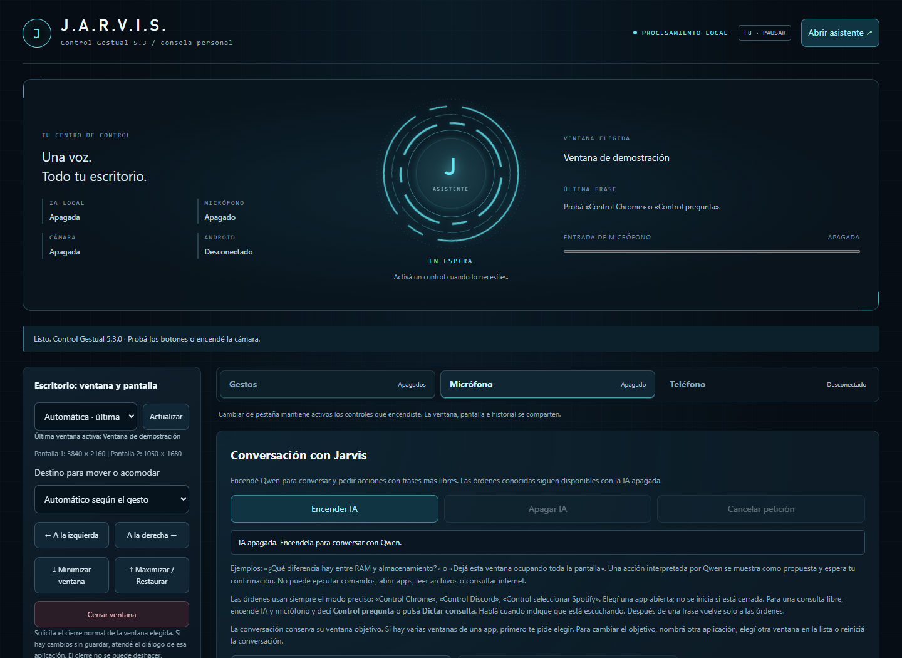

# ControlGestual · Jarvis desktop assistant

Local Windows desktop control using hand gestures, Spanish voice commands and optional local AI. Version **5.3** adds a Jarvis-inspired console with visual states driven by the application itself.



## What it does

- Move complete application windows between monitors; minimize, maximize, restore and arrange them.
- Recognize hand gestures through a webcam with MediaPipe, including configurable thumb/finger contacts.
- Recognize Spanish commands offline using Vosk, with explicit names such as `Control Chrome` and `Control Discord` for open applications.
- Keep a target across a conversation; confirm window closures and all model-generated actions.
- Optionally run Qwen3 1.7B through a dedicated local Ollama instance, with cancellation and an allowlist of window actions.
- Control an Android phone through ADB/scrcpy after local wireless pairing.
- Offer a local browser UI, tray controls, undo history, emergency pause and optional spoken replies.

## Scope and limits

Windows desktop project with Spanish interaction. It moves complete windows; individual Chrome tabs use the separate extension under `extension/`. It does not launch closed applications, browse the web, read files/screens or execute arbitrary shell commands through the assistant. The AI is optional and starts disabled. Closing a window uses the normal application close request; unsaved-document prompts remain the responsibility of the target app.

## Run from source on Windows

Developed and packaged with Python 3.14.4 and Node.js. Use a virtual environment; no global installation is required:

```powershell
py -3 -m venv .venv
.venv/Scripts/python -m pip install vosk==0.3.45 sounddevice==0.5.5
.venv/Scripts/python scripts/prepare_assets.py
.venv/Scripts/python scripts/prepare_voice_assets.py
# Optional Android tools:
.venv/Scripts/python scripts/prepare_phone_tools.py
.venv/Scripts/python desktop_app.py
```

Preparation downloads the declared third-party assets. Runtime webcam and voice processing use local assets. Camera, microphone and AI must be explicitly activated. `F8` pauses control.

The optional Qwen integration expects a separately prepared `local-ai` folder; the multi-gigabyte model/runtime and private settings are intentionally excluded from Git. See `desktop_llm.py` for the pinned model and runtime layout. A fresh source checkout supports gesture/command features after asset preparation; the AI is not automatically provisioned.

## Verify

```powershell
npm test
.venv/Scripts/python -m unittest discover -s tests -p "test*.py"
```

Browser checks under `scripts/` require Playwright and explicit `CONTROL_GESTUAL_NODE_MODULES` and `CONTROL_GESTUAL_CHROMIUM` paths. Tests use synthetic camera/voice fixtures or disposable test windows; they do not replace real-device calibration. See [verification notes](VERIFICATION.md) for executed checks and limitations.

## Source and third-party assets

Python coordinates Win32, audio, the local HTTP server and optional model/phone processes; JavaScript handles the interface and gesture worker. Asset manifests and third-party notices are retained. No open-source license is granted for the original project code in this repository; third-party components retain their own licenses.

---

## Guía detallada en español e historial

# Control Gestual 5.3

Aplicación local para **mover ventanas de aplicaciones del escritorio de Windows** entre monitores. Incluye botones y detección de mano. El panel se muestra en Chrome, pero el movimiento lo realiza Windows: la aplicación elegida no necesita ser un navegador.

## Nueva versión

### Consola visual Jarvis (5.3)

Nuevo panel oscuro con acentos cian, núcleo circular animado y estados reales de espera, escucha, procesamiento, respuesta y confirmación. Vista conjunta de IA, micrófono, cámara y Android; acceso directo a la conversación; herramientas reorganizadas y diseño adaptable. Abrir asistente solo cambia de pestaña: no activa dispositivos ni el modelo. Respeta la preferencia de movimiento reducido del sistema. Los comandos precisos de 5.2 se conservan.


### Corrección del reconocimiento de aplicaciones (5.2)

Las órdenes conservan siempre la gramática precisa de 5.0, incluso con Qwen encendido. En 5.1 se reemplazaba por dictado libre al activar la IA; el contraste con audio sintético reprodujo Chrome -> crm y Discord -> discordia. Además, Discord no estaba en los nombres registrados del usuario. Se añadieron Discord, Spotify, Steam, WhatsApp, Explorador y Edge mediante una migración que respeta nombres propios y eliminaciones posteriores.

Ahora podés decir **Control Chrome**, **Control Discord** o **Control seleccionar Spotify** para seleccionar una aplicación abierta. No se inicia una app cerrada. Las frases personalizadas existentes tienen prioridad y las aplicaciones excluidas siguen protegidas. En once muestras comparadas, el dictado libre anterior no resolvió selección directa de app; la gramática de comandos resolvió las once. Es evidencia con audio sintético, no una medición de la voz del usuario.

Para una consulta libre con IA, encendé el micrófono y decí **Control pregunta** o pulsá **Dictar consulta**. Cuando indique que escucha una consulta, decí una sola frase. Vuelve automáticamente a las órdenes al recibirla, rechazarla por baja confianza o vencer veinte segundos. La IA no cambia por sí sola el reconocimiento de comandos. Las acciones provenientes de una consulta dictada requieren confirmación incluso cuando coinciden con una orden del intérprete. F8 y Control apagar micrófono mantienen su función. No se añadió fuzzy matching de nombres ni se redujo el umbral de las órdenes.

### IA local Qwen integrada (5.1)

En Micrófono, **Encender IA** inicia una instancia propia de Ollama 0.40.13 con Qwen3 1.7B, accesible únicamente desde este equipo y con nube desactivada. Usa la carpeta local-ai ya preparada, sin volver a descargar el modelo. Comienza apagada en cada sesión. La primera consulta puede tardar alrededor de un minuto; el panel muestra cuándo está pensando y permite cancelar con Cancelar petición o F8. Apagar IA o salir termina solamente el motor y runners iniciados por esta instancia.

Podés preguntar por texto, por ejemplo Qué diferencia hay entre RAM y almacenamiento, o pedir una acción con otras palabras. Las órdenes conocidas conservan su camino directo; los pedidos nuevos pasan por Qwen. La salida de Qwen se valida contra un catálogo de siete acciones y aliases registrados: no se aceptan comandos, rutas, identificadores de ventana ni objetivos inventados. Toda propuesta de Qwen pide confirmación, revalida ventana/título/exclusiones y recién entonces ejecuta la acción existente. La frase que invente el modelo sobre una acción no se usa como confirmación de ejecución. Los pedidos de varias acciones se resuelven de a uno y abrir apps, borrar archivos o ejecutar comandos quedan fuera de esta versión.

En 5.1, el micrófono pasaba a reconocimiento libre al encender la IA. Ese cambio se sustituye en 5.2 por órdenes precisas permanentes y consultas de una sola frase activadas explícitamente. Jarvis se conserva como nombre del asistente. La calidad del micrófono físico queda pendiente de la prueba del usuario.

El modelo recibe el pedido, aliases y hasta cuatro mensajes recientes de la conversación, sin capturas de pantalla ni archivos. No tiene herramientas de shell, red ni acceso a la API del controlador. Se procesa localmente. Las respuestas generales pueden contener errores y no incluyen información en vivo. El cierre de ventana conserva la confirmación anterior incluso sin IA.

La versión instalada encuentra local-ai en la raíz del proyecto. Para una copia portátil, colocá esa carpeta junto al ejecutable; los 4,9 GB de preparación no se duplican dentro del ZIP de la app. No copies state ni integration-state al compartir el motor: contienen estado privado de las instancias. Si faltan los recursos, el panel lo informa y las funciones anteriores siguen disponibles.

### Asistente local Jarvis (5.0)

En Micrófono hay una conversación por texto y voz para controlar ventanas abiertas. Ejemplos de voz comprobables: **Jarvis pasa Chrome a la derecha**, **Jarvis por favor mueve Chrome a la izquierda**, **Jarvis ahora maximizar**, **Jarvis minimiza esta ventana**, **Jarvis segunda**, **Jarvis qué ventana** y **Jarvis cancelar**. El texto admite también frases como Ahora maximizalo o Podrías dejar esta ventana grande. Se conservan los comandos Control anteriores.

Se reutilizan las acciones de Windows con exclusiones, comprobación HWND/PID y pausa. El objetivo de la conversación se conserva aunque actives otra ventana; nombrá otra aplicación, cambiá la selección de la lista compartida o reiniciá la conversación para cambiarlo. Si hay de dos a cinco ventanas de una aplicación, el asistente pregunta cuál y espera una elección por voz o botón durante treinta segundos. No elige una al azar. Si la ventana original se cierra o cambia, no salta a otra automáticamente. Seleccionar establece el objetivo de la conversación; las acciones posteriores se aplican a esa ventana.

Jarvis pide confirmar antes de cerrar: muestra la ventana y espera Jarvis confirmar o Jarvis cancelar durante treinta segundos. Se vuelve a comprobar identidad y título antes del cierre; un cambio cancela la solicitud. Control cerrar y el botón de cierre conservan su comportamiento anterior. Hay un botón de micrófono junto a la conversación, el historial visible tiene altura limitada y el aviso global no tapa los controles al desplazarse.

**Responder en voz alta** habilita la voz española instalada en Windows, mediante System.Speech local. Comienza apagado y conserva la preferencia. Mientras habla y durante un margen posterior de 700 ms, el reconocedor descarta el audio y reinicia su estado para evitar órdenes provocadas por el propio altavoz. F8, pausa de bandeja y apagar micrófono detienen la salida. Si no hay voz española o falla el dispositivo de salida, el texto sigue disponible y se muestra el error. La síntesis se invoca con texto por JSON/stdin, nunca como código de shell.

El intérprete acotado de 5.0 se conserva para órdenes conocidas. La versión 5.1 agrega Qwen como opción para conversación y nuevas formulaciones; siguen sin incluirse lectura de pantalla, automatización de sitios ni inicio de aplicaciones cerradas. La conversación vive en memoria de la sesión, con hasta veinte mensajes visibles; no se escribe en ajustes ni se envía a servicios externos. Las versiones anteriores y la conexión con Android permanecen disponibles.

Referencias de implementación: [síntesis local de Windows](https://learn.microsoft.com/en-us/dotnet/api/system.speech.synthesis.speechsynthesizer), [vocabulario dinámico de Vosk](https://github.com/alphacep/vosk-space/blob/master/adaptation.md).

- **Cerrar ventanas de Windows:** botón Cerrar ventana, Control cerrar (también Control cerrar ventana o Control cerrar aplicación) y acción configurable en los gestos. Se envía la solicitud normal de cierre a la ventana seleccionada, respetando las aplicaciones excluidas. Si la aplicación pide guardar o cancela el cierre, resolvelo allí. No se cierran todas las ventanas del proceso ni se fuerza su terminación. El cierre no agrega una entrada a Deshacer y conserva el historial anterior. En un navegador, cerrar la ventana puede cerrar todas sus pestañas. Android conserva sus controles existentes.

- **Contactos con el pulgar:** pulgar + índice para mitades; pulgar + medio para cambiar de aplicación, maximizar o minimizar; pulgar + anular para los cuatro cuadrantes. No requieren cambiar el perfil del puño.
- **Mitades y cuartos:** controles en el panel y acciones asignables a los gestos.
- **Cambiar de aplicación:** ventana anterior/siguiente entre las aplicaciones permitidas.
- **Elegir monitor:** destino fijo para mover y acomodar, o automático.
- **Perfiles:** Ventanas, Organizar, Navegar y Personalizado; cuatro direcciones configurables o desactivadas.
- **Excluir aplicaciones:** por nombre exacto del ejecutable; también se respeta al cambiar de aplicación y deshacer.
- **Historial de 20 acciones:** deshacer paso a paso y descartar registros de ventanas cerradas.
- **Ejecutable sin consola:** incluye Python y Tkinter; continúa necesitando Chrome para el panel y la webcam.

## Teléfono Android por Wi-Fi (4.1)

Se agregó una tercera pestaña, Teléfono. La vinculación es local: misma red, Android 11 o posterior y Depuración inalámbrica habilitada. No requiere USB. Las herramientas portátiles oficiales scrcpy 5.0.1 y ADB 37.0.1 se incluyen dentro del paquete; el SHA-256 oficial y los archivos se registran en PHONE_ASSETS.json. No se instala Android Studio, no se cambia PATH ni la configuración global.

1. En el teléfono abrí Depuración inalámbrica → Vincular dispositivo con código. Ingresá en el panel la IPv4 privada, el puerto de ese diálogo y el código. El código se envía por stdin a ADB, nunca en argumentos de proceso, se borra del formulario y no se guarda en preferencias ni estado.
2. Volvé a la pantalla principal de Depuración inalámbrica. Copiá su puerto de conexión, que es distinto del de vinculación, y pulsá Conectar. Si el código venció, generá uno nuevo. En conexiones posteriores con la misma identidad podés saltar vinculación y conectar con el puerto actual.
3. Usá Ver pantalla para abrir una ventana scrcpy separada. Se desactivan audio reenviado, grabación y sincronización automática de portapapeles. Se admiten mouse y teclado en esa ventana. Pausar órdenes también cierra el espejo.
4. Hay botones y órdenes de voz para inicio, volver, recientes, desplazamientos, volumen, reproducción/pausa, Chrome y Ajustes. No se ejecuta shell arbitrario, no se desbloquea el teléfono, no se leen mensajes ni se envían comunicaciones automáticamente. La apertura de Chrome valida su componente; una aplicación ausente se rechaza.
5. Para gestos, marcá Usar el puño para el teléfono y encendé cámara en Gestos. Izquierda vuelve, derecha abre recientes, arriba y abajo desplazan. Los otros contactos se cancelan en ese modo para no actuar sobre Windows por error. La pérdida o pausa del control desmarca el modo y apaga la cámara, sin cambiar silenciosamente al escritorio. Usá el teléfono vertical para los desplazamientos automáticos.

Cada orden lleva el dispositivo seleccionado explícitamente. La app usa un servidor ADB propio en loopback con puerto independiente y claves/preferencias/temporales bajo phone-private al lado del ejecutable; no usa ni detiene el servidor ADB predeterminado de otras herramientas. La autorización debe revocarse desde Android si dejás de confiar en esta PC. No compartas phone-private. Esa carpeta y los ajustes personales se excluyen del ZIP. Al recompilar la misma distribución se conserva la carpeta privada de su backup local. No se publican códigos ni direcciones del teléfono en este chat.

F8, Escape, Pausar en bandeja y Control detener todo pausan cámara, micrófono y órdenes al teléfono, y cierran el espejo. Cerrar la app termina su espejo y su servidor ADB propio. Desconectar borra la selección actual aunque Android no responda. Un estado conectado es la última verificación; usá Verificar conexión si cambiaste de Wi-Fi o puerto. Algunos fabricantes pueden requerir permisos de control adicionales: la app informa el rechazo y no modifica permisos por su cuenta.

Fuentes oficiales: [scrcpy Windows y hashes](https://github.com/Genymobile/scrcpy/blob/master/doc/windows.md), [conexión Wi-Fi](https://github.com/Genymobile/scrcpy/blob/master/doc/connection.md), [emparejamiento Android](https://developer.android.com/tools/adb#wireless-android11-command-line) y [preferencias de herramientas Android](https://developer.android.com/tools/variables).

## Herramientas nuevas (4.0)

1. **Prueba guiada:** en Micrófono, encendé audio e iniciá la prueba. Primero guardá silencio dos segundos para estimar el fondo; después repetí las tres frases. Se pausan los gestos y las frases de práctica no ejecutan acciones. El resumen muestra coincidencia, confianza, volumen máximo y saturación. Al terminar o cancelar, la voz queda pausada hasta Control continuar. No modifica el modelo acústico ni guarda audio.
2. **Confirmación:** el panel y el indicador flotante muestran la acción prevista y su resultado. Podés habilitar Sonido al completar; empieza deshabilitado para no sorprenderte. El sonido indica que finalizó la solicitud, no garantiza que un reproductor haya cambiado su estado.
3. **Frases propias:** Frases personalizadas permite, por ejemplo, grande → Maximizar. Decí Control grande. Se validan nombres, acciones y palabras presentes en el modelo; no se permite reemplazar órdenes reservadas. Se guardan en settings.json y la gramática se actualiza al guardar, sin reiniciar el micrófono.
4. **Aplicaciones por nombre:** Control seleccionar chrome, Control seleccionar bloc notas o Control seleccionar codex. Podés registrar otros nombres con las aplicaciones abiertas. Se respeta la exclusión. Si hay varias ventanas, se elige la última conocida de esa aplicación o se pide resolver la ambigüedad desde la lista. No se abre software cerrado.
5. **Scroll:** Control scroll arriba/abajo o botones manuales. Cada orden envía tres pasos de rueda a la ventana elegida. El puntero se dirige brevemente a su centro y vuelve si no lo moviste; se comprueba que no haya otra ventana tapándolo. Para gestos, usá Asignar scroll arriba/abajo a pulgar + meñique, o elegí las acciones en los perfiles. Se conservan los laterales del meñique y los demás gestos.
6. **Multimedia:** Control volumen arriba/abajo, Control silencio, Control musica, Control pista siguiente/anterior. También hay botones y acciones asignables a gestos. Se envían teclas multimedia estándar a Windows; el volumen es del sistema y la reproducción la atiende el reproductor activo. Scroll y multimedia no se pueden deshacer; no crean entradas ficticias en el historial.
7. **Distribuciones favoritas:** acomodá las ventanas, elegí de una a ocho en la lista, escribí trabajo o estudio y guardá. Aplicá desde el botón o con Control modo trabajo. Se guarda ejecutable, título, pantalla y geometría relativa, sin IDs de ventana persistentes. Se admiten posiciones normales o maximizadas; recuperá las minimizadas antes de guardar. No se sobrescribe un modo existente: eliminá el anterior si querés reemplazarlo. Antes de aplicar se comprueba que todas las ventanas y pantallas estén disponibles y permitidas; un error revierte los cambios ya hechos. Si Windows también rechaza la recuperación, se informa y se conserva una entrada de Deshacer para reintentar. Deshacer de un modo recupera las posiciones como grupo.

Los alias y modos viven únicamente en los ajustes locales. El ZIP excluye ajustes personales. Una palabra desconocida del modelo se rechaza con una explicación para elegir un alias común; no se ignora silenciosamente. Una aplicación puede ignorar scroll o multimedia, o imponer tamaños mínimos. La prueba con voz sintética no sustituye una prueba con tu cámara, voz y aplicaciones reales.

## Dos pestañas (3.1)

- **Gestos:** cámara, contactos con el pulgar, asignaciones, perfil del puño, sensibilidad y calibración.
- **Micrófono:** encender/apagar audio, estado, última orden y lista completa de comandos.

La ventana, pantalla de destino, controles manuales, exclusiones, historial, bandeja y cierre se comparten. Los indicadores junto a cada pestaña muestran si su control está activo incluso cuando estás en la otra. Cambiar de pestaña no reinicia la cámara, el trabajador ni el micrófono y no cambia el objetivo elegido. Los controles empiezan apagados como antes.

Se pueden usar las pestañas con clic o con las flechas del teclado; Inicio y Fin van a Gestos y Micrófono. F8 y Escape mantienen su función de pausa global.

## Voz local (3.0)

El micrófono empieza apagado. Elegí la ventana y el monitor de destino, y pulsá **Encender micrófono**. Se usa el micrófono elegido o el predeterminado de Windows (permiso para aplicaciones de escritorio). Funciona sin cámara y con el panel oculto. Procesa audio localmente con Vosk 0.3.45, sounddevice 0.5.5 y el modelo español `vosk-model-small-es-0.42`, incluido en la distribución; no descarga modelos ni envía audio al ejecutar. No guarda grabaciones ni historial de conversaciones. El panel conserva en memoria la última frase y la transcripción provisional, sin un historial de conversaciones.

Decí **Control** seguido de una orden completa y esperá la respuesta antes de repetir. El reconocedor ignora hipótesis parciales y frases que no coinciden exactamente. Una voz de fondo podría activar una orden: usá Apagar micrófono cuando no lo necesites. No hay identificación de hablante.

**Control pausar** pausa las acciones por voz y sigue escuchando **Control continuar**. No reenciende la cámara. **Control apagar micrófono** deja de escuchar; para volver, usá el botón del panel. **Control detener todo**, F8 y Pausar en bandeja detienen el micrófono y pausan los gestos. Escape hace lo mismo desde el panel. Cerrar el panel solicita apagar ambos dispositivos; ocultarlo conserva los controles que estaban activos.

**Maximizar** y **restaurar** son estados explícitos; no alternan accidentalmente si se repite la orden. **Maximizar o restaurar** conserva la alternancia del botón original. Todas las acciones reutilizan exclusiones, validación de ventana y Deshacer. El destino de voz sigue el selector del panel, o se puede elegir con destino pantalla uno/dos/tres/cuatro según el orden mostrado; una pantalla ausente se rechaza. Cambiar manualmente de objetivo descarta audio de la selección anterior. No se agregan gestos para cambiar ajustes, calibrar, cerrar aplicaciones ajenas ni dictar texto.

### Órdenes cortas y claridad (3.2)

Las órdenes recomendadas son más cortas: Control mover izquierda/derecha, Control siguiente/anterior, Control mitad arriba/abajo y Control pantalla uno/dos/tres/cuatro. Control mover sin dirección no ejecuta nada. Las frases anteriores siguen admitidas como alias, pero la lista del panel muestra las formas breves.

La pestaña Micrófono permite buscar y elegir un dispositivo de entrada antes de encenderlo. El dispositivo predeterminado sigue disponible. No se puede cambiar de micrófono durante la captura: apagalo primero. La selección de dispositivo no se guarda entre reinicios.

El medidor muestra nivel de señal, silencio/señal baja y saturación. Se muestra una transcripción provisional mientras hablás y el resultado final, incluso si no coincide con un comando. Las transcripciones parciales nunca ejecutan acciones. El motor entrega confianza por palabra; se rechaza una orden si la palabra menos clara tiene una puntuación inferior a 0,60. Esa puntuación es una estimación del modelo, no una garantía de exactitud. Las pruebas con voz sintética no acreditan mejora de precisión con el micrófono, acento y ruido reales del usuario. No se agregó reducción de ruido ni se cambió el modelo acústico.

### Comandos completos

- Control mover izquierda
- Control mover derecha
- Control minimizar
- Control maximizar
- Control restaurar
- Control maximizar o restaurar
- Control mitad izquierda
- Control mitad derecha
- Control mitad arriba
- Control mitad abajo
- Control cuarto arriba izquierda
- Control cuarto arriba derecha
- Control cuarto abajo izquierda
- Control cuarto abajo derecha
- Control siguiente
- Control anterior
- Control deshacer
- Control pausar
- Control continuar
- Control apagar micrófono
- Control detener todo
- Control mostrar panel
- Control ocultar panel
- Control automático
- Control descartar
- Control scroll arriba
- Control scroll abajo
- Control volumen arriba
- Control volumen abajo
- Control silencio
- Control musica
- Control pista siguiente
- Control pista anterior
- Control telefono inicio
- Control telefono volver
- Control telefono aplicaciones
- Control telefono arriba
- Control telefono abajo
- Control telefono volumen arriba
- Control telefono volumen abajo
- Control telefono musica
- Control telefono chrome
- Control telefono ajustes
- Control telefono pantalla
- Control telefono pausar
- Control telefono continuar
- Control telefono desconectar
- Control pantalla uno
- Control pantalla dos
- Control pantalla tres
- Control pantalla cuatro

Además, aparecen las frases personales, seleccionar + nombre y modo + nombre que hayas guardado.

**Puesta a punto desde código:** usar el entorno local `work/build-env` con `scripts/requirements-build.txt`; `python scripts/prepare_voice_assets.py` descarga el modelo una sola vez. Fuentes, licencia y hashes en `VOICE_ASSETS.json`. Ver [modelo y licencia oficiales](https://alphacephei.com/vosk/models) y [ejemplo oficial de captura local](https://github.com/alphacep/vosk-api/blob/master/python/example/test_microphone.py).

## Abrir el ejecutable

En este proyecto, abrir `ControlGestual 5.2.lnk` o `releases/ControlGestual-V5.2/ControlGestual-V5.2.exe`. En el paquete portable, extraer toda la carpeta y abrir `ControlGestual-V5.2.exe`; conservar `_internal` junto al ejecutable. No se necesita instalar Python para usar esa versión. `Iniciar.cmd` prefiere el ejecutable y utiliza `pyw` con el código fuente como alternativa.

Antes de cambiar de versión, elegir **Salir** en la bandeja de la versión anterior. Cerrar solo el panel no termina su controlador. La versión nueva evita abrir una segunda instancia desde la misma carpeta; usar la bandeja para mostrarla.

Los ajustes viven en `settings.json` junto al ejecutable o junto a `desktop_app.py` cuando se usa el código fuente. La compilación conserva una copia local de la distribución anterior e incorpora los ajustes del proyecto si todavía no había ajustes propios de la distribución. No se agrega inicio automático con Windows.

### Gestos con dedos (3.0)

Todos empiezan con mano abierta. Juntá la punta del dedo con el pulgar durante aproximadamente medio segundo hasta ver la ventana seleccionada, desplazá manteniendo ese contacto y separalos para confirmar. Mantené los otros dedos relajados y al menos dos extendidos. El puño conserva sus acciones y se confirma abriendo la mano. Hay 1,5 segundos de espera después de cada confirmación.

| Contacto | Movimiento | Acción predeterminada |
| --- | --- | --- |
| Puño | ← / → / ↑ / ↓ | Acciones del perfil del puño; Ventanas mueve entre monitores, maximiza/restaura o minimiza |
| Pulgar + índice | ← / → / ↑ / ↓ | Mitad izquierda / derecha / superior / inferior |
| Pulgar + medio | ← / → | Aplicación anterior / siguiente |
| Pulgar + medio | ↑ / ↓ | Maximizar/restaurar / minimizar |
| Pulgar + anular | ↖ / ↗ / ↙ / ↘ | Cuarto correspondiente |
| Pulgar + meñique | ← / → | Aplicación anterior / siguiente |

**Personalizar acciones de los dedos** permite cambiar o desactivar cada contacto sin alterar el perfil del puño. Pulsá **Guardar gestos de dedos**. La inversión izquierda/derecha también invierte las diagonales. Se conservan las asignaciones de 2.1 en el mismo orden: índice pasa a pulgar + índice, índice y medio pasa a pulgar + medio, tres dedos pasa a pulgar + anular. Se conservan calibración, sensibilidad, perfiles y exclusiones. Los nombres internos de las tres familias se mantienen para leer los ajustes existentes.

Se reconoce cercanía de puntas, no presión física. La distancia se normaliza por el ancho de la palma, con umbrales separados para contactar y soltar. Se requieren 350 ms para capturar el contacto y 120 ms de separación para confirmar. Contactos múltiples o cambiar de dedo durante el recorrido cancelan la acción. Pulgar + meñique cambia a la aplicación anterior (izquierda) o siguiente (derecha); arriba y abajo quedan desactivados por defecto. Si había una ventana elegida manualmente, la selección sigue a la aplicación activada para permitir cambios sucesivos. En modo automático se conserva la selección automática. La mano y las puntas deben verse; la cámara puede confundir superposiciones. Los contactos pertenecen al escritorio; la extensión de Chrome conserva su activación por puño. El reconocimiento se prueba con puntos sintéticos; la precisión con webcam física requiere comprobación manual.

### Distribuciones y destino

Los controles de Acomodar aplican mitades izquierda/derecha/superior/inferior y cuatro cuartos. En modo automático se usa el monitor actual para acomodar y el vecino para trasladar. Con destino fijo, tanto mover como acomodar usan ese monitor; los gestos laterales dejan de elegirlo por su sentido. Si una aplicación impone un tamaño mínimo que impide la distribución, se recupera la posición anterior y se informa el motivo.

### Perfiles y exclusiones

**Ventanas** conserva izquierda/derecha para mover, arriba para maximizar/restaurar y abajo para minimizar. **Organizar** asigna las cuatro mitades. **Navegar** usa izquierda/derecha para aplicación anterior/siguiente. **Personalizado** permite asignar cualquiera de las acciones, incluidos cuartos y Desactivado. Pulsar **Guardar perfil y gestos** para aplicar. La calibración y sensibilidad se conservan al cambiar de perfil.

En Aplicaciones excluidas, escribir un ejecutable por línea (`notepad.exe`, por ejemplo), o elegir una ventana y pulsar **Excluir aplicación elegida**. No se admiten rutas ni comodines. Las exclusiones se comprueban también para capturas de gesto anteriores. El cambio de aplicación omite las excluidas. Para deshacer sobre una aplicación excluida después de la acción, quitar su exclusión o descartar ese registro.

### Historial

El historial conserva hasta 20 acciones durante la sesión. Deshacer o Ctrl+Alt+Z recuperan un paso por vez; también puede deshacerse un cambio de foco entre aplicaciones. Un intento fallido no elimina pasos anteriores. Descartar último registro permite llegar al paso anterior si la ventana se cerró. La geometría se guarda solo en memoria y se borra al salir.

Windows puede impedir cambiar el foco en aplicaciones protegidas, que no responden o durante ciertos estados del sistema. En ese caso se informa el fallo; no se solicita elevación ni se inyectan combinaciones de teclado.

## Iniciar el control del escritorio

1. Abrir el ejecutable o acceso directo indicado arriba. Para desarrollo, ejecutar `python desktop_app.py`.
2. Se abre un panel local en una ventana de Chrome. **No es necesario instalar la extensión para mover ventanas del escritorio.**
3. Por defecto se usa **Automática · última ventana activa**: activar la aplicación que se quiere mover. También se puede elegir una ventana fija por título. Pulsar **Actualizar** si se abrió o cerró alguna aplicación.
4. Probar primero los botones izquierda/derecha con una ventana sin trabajo importante.
5. El panel muestra la última ventana activa; el propio panel y el indicador flotante se excluyen. Al cerrar el puño, la selección queda fijada para ese gesto aunque cambie el foco después.
6. Pulsar **Encender cámara** y conceder el permiso. Mostrar la **mano abierta**, cerrarla en un puño para agarrar, desplazar la mano hacia un lado y **abrirla para soltar y mover**. La dirección se decide por el desplazamiento de la palma. Cada cierre y apertura deben mantenerse unos 120 ms para evitar activaciones por un solo fotograma. Recorrer aproximadamente un quinto del ancho de la imagen; hay 1,5 segundos de descanso entre acciones. Abrir sin desplazamiento suficiente cancela el gesto.
7. **F8** pausa los gestos desde cualquier aplicación del mismo escritorio interactivo de Windows. El panel apaga la captura al recibir la pausa; no cancela un movimiento ya enviado. **Escape** funciona con el panel enfocado.
8. Para terminar, pulsar **Cerrar aplicación y cámara**, elegir **Salir** en el icono de bandeja o apagar la cámara y presionar Ctrl+C en la consola. Cerrar solo el panel detiene la captura y deja la bandeja disponible para volver a abrirlo.

### Calibración y sensibilidad

Con la cámara encendida, pulsar **Calibrar mano** y mantener la mano abierta durante unos dos segundos. Después cerrar el puño y pulsar **Capturar puño**; mantenerlo quieto otros dos segundos. Los gestos quedan suspendidos durante ambas capturas. Se necesitan al menos 15 muestras válidas por postura; si no se distinguen o varían demasiado, se rechaza la captura y se conserva la calibración anterior.

El control **Recorrido necesario** permite elegir entre 8% y 35% del encuadre; un porcentaje menor requiere menos desplazamiento. La sensibilidad, inversión de dirección y calibración se guardan localmente en `settings.json` dentro de este proyecto, sin imágenes ni puntos de la mano. **Restablecer calibración** vuelve al detector predeterminado y conserva los otros ajustes. Estos ajustes son de la aplicación de escritorio; la extensión opcional mantiene sus valores predeterminados.

### Maximizar, minimizar y recuperar

Para minimizar: mostrar mano abierta, cerrar el puño, **bajarlo** y abrir la mano. El gesto debe ser predominantemente vertical hacia abajo; las diagonales ambiguas se cancelan. También existe el botón **Minimizar ventana**. Se minimiza la ventana completa de la aplicación, incluidas sus pestañas; no se oculta una pestaña individual.

Para **maximizar**, cerrar el puño, **subirlo** y abrir la mano. Si la ventana ya está maximizada, el mismo gesto la restaura a su tamaño normal. Si está minimizada, la recupera directamente maximizada. También está el botón **Maximizar / Restaurar**. La sensibilidad se aplica a todos los sentidos; invertir izquierda/derecha no cambia arriba/abajo. Las ventanas sin soporte de maximización se rechazan con un mensaje y no reemplazan el registro de deshacer.

Después de minimizar, el modo automático conserva esa ventana como objetivo, sin cambiar inmediatamente a la que Windows dejó en primer plano. El panel muestra cuál se puede recuperar con el gesto hacia arriba. Cambiar a una aplicación distinta de la que quedó detrás libera esa selección; para controlar la ventana que quedó detrás, elegirla explícitamente en la lista. Si la ventana minimizada se cerró o ya fue restaurada por otro medio, se vuelve al seguimiento normal.

**Deshacer última acción** revierte mover, minimizar y maximizar/restaurar, recuperando la posición y maximización anteriores. Hay hasta 20 pasos. **Ctrl+Alt+Z** ejecuta Deshacer desde otras aplicaciones mientras el programa está abierto y el atajo haya podido registrarse; si otra aplicación ya lo ocupa, el panel lo informa y conserva el botón y la opción de bandeja.

### Segundo plano y bandeja

Con la cámara activa, pulsar **Ocultar panel y seguir con la cámara**. El icono junto al reloj permite **Mostrar panel**, **Ocultar panel**, **Pausar cámara**, **Deshacer** y **Salir**. Doble clic en el icono muestra el panel. Si se cerró con la X, Mostrar panel vuelve a abrirlo, pero la cámara debe encenderse manualmente.

La detección utiliza `MediaStreamTrackProcessor` y un trabajador con `OffscreenCanvas`. Tanto el modelo como el reconocimiento temporal de abrir/cerrar/desplazar se ejecutan en ese trabajador, sin depender del dibujo de la página. Tolera intervalos entre detecciones de hasta 1,2 segundos; pausas mayores cancelan el agarre. **Minimizar u ocultar el panel conserva la captura; cerrarlo la detiene.** F8 y Pausar cámara siguen disponibles. El trabajador comprueba el estado de pausa local para no depender de temporizadores de una página oculta. La interfaz descarta mensajes de gestos anteriores a una cancelación o cambio de ajustes. El botón de ocultar se desactiva si Windows no pudo crear el icono de bandeja.

No se garantiza procesamiento durante suspensión del equipo, bloqueo de sesión, descarte de la página por Chrome o desconexión de cámara. La experiencia con la webcam física todavía requiere prueba manual.

### Indicador y deshacer

La cámara dibuja las articulaciones y un contorno de la mano: **verde al detectarla y ámbar al agarrar**. Una etiqueta distingue mano abierta, puño cerrado y postura intermedia. Al perder la mano o apagar la cámara, se borra el dibujo. La superposición respeta el espejo y las bandas laterales de la imagen.

Al soltar, la ventana realiza una transición de unos 240 ms con posición y tamaño interpolados. En la extensión, una pestaña se separa primero en una ventana en origen y luego se anima esa ventana hasta el destino. Las ventanas maximizadas recuperan la maximización al terminar. Algunas aplicaciones pueden limitar la fluidez o el tamaño. Si Chrome rechaza una posición intermedia entre pantallas, se intenta la posición final; la transición puede acortarse en ese caso.

Durante la selección aparece el nombre de la ventana en el panel y en un indicador flotante sobre el escritorio. La flecha indica el sentido cuando el recorrido supera el umbral de movimiento. El indicador no toma el foco, se excluye de la selección automática, se oculta al cancelar o pausar y caduca después de cinco segundos. Requiere el Tkinter que viene con Python.

**Deshacer última acción** recupera la posición, tamaño y maximización anteriores de la última ventana movida, minimizada o maximizada/restaurada con éxito. Hay hasta 20 pasos disponibles hasta cerrar la aplicación. Un intento fallido no reemplaza ese registro. Si se cerró la ventana o se desconectó su pantalla original, se informa el problema sin mover otra ventana. No deshace separaciones de pestañas de la extensión.

Después de actualizar los archivos, cerrar la aplicación anterior y volver a ejecutar `Iniciar.cmd`. Si se usa también la extensión, recargarla en `chrome://extensions`.

### Cómo funciona

`desktop_app.py` abre un servidor HTTP **solo en 127.0.0.1**, en un puerto libre y con una clave aleatoria por ejecución. Las operaciones requieren esa clave, validación de Host y origen. No acepta comandos de consola. `desktop_windows.py` consulta monitores y ventanas mediante Win32 y mueve la ventana seleccionada con `SetWindowPos`; para deshacer usa `GetWindowPlacement`/`SetWindowPlacement`, conservando el sistema de coordenadas de Windows. `desktop_overlay.py` muestra el indicador desde un proceso hijo sin consola, conectado por una tubería privada que se cierra al salir. No cambia la distribución de pantallas, no instala servicios, no se inicia con Windows y no solicita elevación.

La cámara y el modelo MediaPipe se procesan en un trabajador local del navegador. El servidor recibe identificadores de ventana, órdenes y ajustes, no imágenes. La lista de títulos de ventanas permanece en el equipo. La bandeja y el atajo global existen únicamente mientras la aplicación está abierta y se retiran al salir.

### Compatibilidad y límites del escritorio

- Pensado para ventanas normales de aplicaciones de Windows. Conserva maximización y ajusta el tamaño solicitado al área útil del destino.
- Algunas aplicaciones imponen tamaños mínimos o rechazan movimientos; no se promete compatibilidad universal sin probarlas. Restaurar ventanas minimizadas y salir de juegos/pantallas completas antes de moverlas.
- Una aplicación ejecutada como administrador o protegida puede rechazar el control desde un proceso normal. No se eleva automáticamente.
- **Las pestañas internas de cada aplicación son específicas de esa aplicación.** La versión de escritorio mueve ventanas completas; para separar pestañas de Chrome se conserva la extensión que se explica debajo. No se implementó un separador universal de pestañas.
- El panel puede ocultarse o minimizarse conservando la cámara. El gesto se cancela tras una pérdida prolongada de seguimiento. Se necesita Chrome con `MediaStreamTrackProcessor`; si no está disponible, se informa y no se deja la cámara activa.
- En el entorno de comprobación de Codex, Win32 informó **una pantalla de 3840 × 2160**. No coincide con las dos pantallas de la captura del usuario. La detección y los movimientos entre sus dos monitores deben verificarse al iniciar la aplicación en su sesión real.

Pruebas del componente de escritorio: `python -m unittest discover -s tests -p test_desktop.py -v`. Ver evidencia y límites en `VERIFICATION.md`.

## Extensión opcional para pestañas de Chrome

Se conserva el prototipo original para separar una pestaña activa de Chrome en una ventana del otro monitor. Tiene su propio panel de cámara: usar un solo panel de cámara a la vez. La extensión no se comunica con el componente de escritorio.

### Cargar en Chrome

1. Abrir `chrome://extensions`.
2. Activar **Modo de desarrollador**.
3. Pulsar **Cargar descomprimida** y seleccionar `C:\Dev\ControlGestual\extension`.
4. Desde el menú de extensiones, fijar **Control Gestual** y pulsar su icono.
5. Abrir una ventana de prueba con dos pestañas. En el panel, elegir la ventana; **Mostrar ventana elegida** permite identificarla.
6. Elegir **Ventana completa** y probar derecha e izquierda. Repetir con **Pestaña activa**. El panel pasa a seleccionar la ventana que acaba de mover.
7. Pulsar **Encender cámara**, conceder acceso a la cámara y mantener el panel visible. El permiso se solicita al iniciar, nunca al cargar la extensión.

### Gestos de la extensión

Mostrar la mano abierta para preparar, cerrarla en un puño, desplazarla horizontalmente y abrirla para soltar y mover. Mantener cierre y apertura unos 120 ms cada uno. Recorrer aproximadamente un quinto del ancho de la imagen. Cada movimiento tiene un descanso de 1,5 segundos. El gesto caduca a los 4 segundos; perder la mano cancela el agarre. El antiguo gesto de juntar índice y medio ya no selecciona una ventana.

La imagen funciona como un espejo. Se puede invertir la dirección desde el panel. Para detener: **Apagar / Pausar**, **Escape** con el panel enfocado o **Alt+Shift+P** dentro de Chrome. Si Chrome tiene ocupado ese atajo, configurarlo en `chrome://extensions/shortcuts`. No es un atajo global de Windows. Cerrar el panel apaga la captura.

### Alcance y límites de la extensión

- Utiliza las pantallas y áreas útiles informadas por Chrome; no modifica la configuración de Windows. No hay salto circular desde el último monitor al primero.
- Ajusta ventanas normales al área disponible y conserva la maximización. Salir de pantalla completa y restaurar ventanas minimizadas antes de moverlas.
- Una pestaña se separa en una ventana nueva. Si es la única pestaña, se mueve la ventana existente. No se recarga la URL ni se copia su contenido.
- La ventana objetivo se elige explícitamente en el panel. En modo pestaña se captura su pestaña activa al iniciar el gesto; si cambia, se cancela el movimiento.
- Solo controla ventanas del perfil de Chrome donde se carga la extensión. No controla otras aplicaciones ni ventanas de incógnito.
- El panel de cámara debe permanecer visible: minimizarlo u ocultarlo puede reducir la frecuencia de procesamiento. La pérdida prolongada de seguimiento cancela el gesto.
- La detección depende de iluminación, cámara y rendimiento. Los umbrales iniciales necesitan una prueba real con el usuario.

### Privacidad y dependencias de la extensión

Sin scripts remotos, permisos sobre sitios web, lectura del historial, grabaciones ni envío de imágenes. Solo solicita `system.display` para consultar monitores y `storage` para recordar los identificadores del panel durante la sesión. Usa las APIs de ventanas y pestañas sin solicitar acceso a sus títulos o URLs. La cámara se procesa en memoria mediante archivos incluidos en `extension/vendor`.

MediaPipe Tasks Vision 1.2.0 (Apache-2.0) se descarga del registro npm oficial. El modelo Hand Landmarker float16 v1 procede del almacenamiento de modelos de Google. `ASSETS.json` registra fuentes, integridad del paquete y hashes de los archivos. La licencia de MediaPipe está en `extension/vendor/LICENSE.mediapipe`. Para volver a preparar los recursos: `python scripts/prepare_assets.py` (requiere Internet únicamente para esa descarga).

### Verificación de la extensión

Ejecutar `npm test` con Node.js. Las pruebas usan monitores y APIs simulados; no sustituyen la comprobación en Chrome con las pantallas reales. Consultar `VERIFICATION.md` para la evidencia de esta versión.

Documentación oficial: [Chrome windows](https://developer.chrome.com/docs/extensions/reference/api/windows), [Chrome system.display](https://developer.chrome.com/docs/extensions/reference/api/system/display), [MediaPipe Hand Landmarker](https://developers.google.com/edge/mediapipe/solutions/vision/hand_landmarker/web_js).

Documentación del componente nativo: [SetWindowPos](https://learn.microsoft.com/en-us/windows/win32/api/winuser/nf-winuser-setwindowpos), [EnumDisplayMonitors](https://learn.microsoft.com/en-us/windows/win32/api/winuser/nf-winuser-enumdisplaymonitors).

## Compilar y verificar

La compilación usa PyInstaller 6.22.3 en `work/build-env`; no instala paquetes globales. Ejecutar `scripts/build_release.ps1`. Las pruebas se ejecutan con `node --test tests/*.test.mjs` y `python -m unittest discover -s tests -p "test*.py" -v`. `scripts/check_frozen.py` comprueba el ejecutable y su bandeja sin abrir la cámara física.
